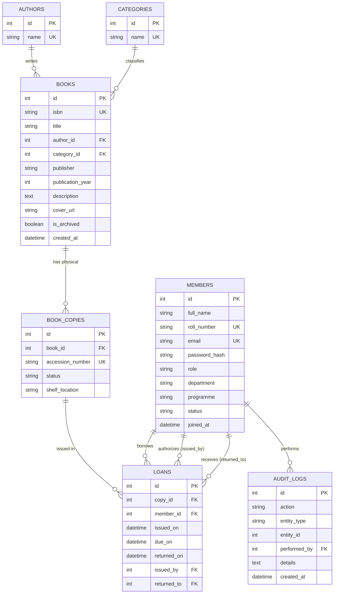

# LIBRANEST: University Library Management System
## Academic Project Report — DBMS TA1 + TA2 Combined Submission

**Institution:** SGT University, Gurugram  
**Programme:** Bachelor of Technology in Computer Science and Engineering (Artificial Intelligence & Machine Learning)  
**Course:** Database Management Systems (DBMS)  
**Academic Year:** 2025–2026  

### Project Team Members
| S.No | Name | Registration / Roll No | Contribution |
| :--- | :--- | :--- | :--- |
| 1 | **Pushkar** | 251302024 | Full-Stack & Database Architecture, Normalization, Schemas |
| 2 | **Prashant** | 251302077 | Backend API (FastAPI), Business Constraints, Fine Engine |
| 3 | **Jatin** | 251302100 | Frontend UI/UX (React + Tailwind CSS), Recharts Data Visualizations, Testing |

---

## 1. Abstract
The conventional management of university library resources across decentralized university departments often experiences operational bottlenecks, including untracked multi-copy book inventories, ambiguous borrower quota enforcement, delayed fine tracking, and inconsistent manual record keeping. **LIBRANEST** is an enterprise-grade, relational database-backed University Library Management System specifically architected to eliminate these challenges. Engineered with a strictly normalized 3NF relational database schema, ACID-compliant transactions, role-based access control, a 14-day borrowing window, and an automated ₹2/day overdue fine calculation engine, LIBRANEST delivers high-integrity institutional inventory control coupled with an intuitive digital portal for students and librarians alike.

---

## 2. Introduction & Problem Statement

### 2.1 Context
University libraries cater to hundreds of students borrowing core textbooks simultaneously across disciplines like Computer Science, Artificial Intelligence, Machine Learning, Database Systems, and Mathematics. Physical books have multiple physical impressions (accessions) on shelves, requiring granular copy-level tracking rather than mere title-level indexing.

### 2.2 Challenges in Traditional / Manual Library Systems
1. **Concurrency and Multiple Copies:** Traditional systems struggle to track which specific physical copy (accession number) is on loan and which remains on the shelf.
2. **Quota Overborrowing:** Students could easily exceed allowable book borrowing allowances without immediate validation.
3. **Inaccurate Late Returns & Fine Estimation:** Manual fine tallying leads to human discrepancy, lost university dues, and friction during clearance.
4. **Data Redundancy & Anomalies:** Un-normalized records result in insertion, deletion, and update anomalies whenever book editions change.
5. **Lack of Student Transparency:** Students lack instant visibility into their personal due dates, active borrowings, and real-time fine accumulations.

### 2.3 Proposed Solution
LIBRANEST provides an end-to-end, web-based relational management platform ensuring:
- **Physical Copy Segregation:** Every book title (`Books`) maps one-to-many to distinct physical inventory items (`Book_Copies`), uniquely indexed by accession numbers.
- **Strict Quota Enforcement:** Strict server-side and database transaction bounds prevent any student account from exceeding **2 active loans**.
- **Automated Fine Calculus:** An algorithmic engine calculates `overdue_days * INR 2.00` per calendar day beyond the 14-day lending period.
- **Role-Based Authorization:** Complete isolation between student interfaces and administrative desks.

---

## 3. Technology Stack

- **Frontend:** React 18, Vite, TypeScript, Tailwind CSS, Lucide Icons, Recharts
- **Backend:** Python 3, FastAPI, Pydantic v2 (Validation & Schemas)
- **Database Layer:** SQLAlchemy ORM, Alembic Migrations
- **RDBMS:** SQLite for zero-configuration local development; PostgreSQL for production deployment
- **Authentication:** OAuth2 with JWT (JSON Web Tokens), Bcrypt password hashing
- **Testing:** pytest, pytest-asyncio, FastAPI TestClient

---

## 4. System Requirements

### 4.1 Functional Requirements
- **FR1 (Authentication):** Secure login for Students and Librarians with role enforcement.
- **FR2 (Catalogue Management):** Administrative CRUD for books, authors, categories, and accession copies.
- **FR3 (Issue Workflow):** Transactional validation of student borrowing limits (max 2) and copy availability.
- **FR4 (Return Workflow):** Copy release, return timestamp capture, and automated fine calculation.
- **FR5 (Dashboard & Visualizations):** Real-time aggregation of inventory counts, category shares, and active loans.
- **FR6 (Audit & Reporting):** Institutional CSV exports of catalogue, active borrowings, overdue accounts, and copies.

### 4.2 Non-Functional Requirements
- **NFR1 (Data Integrity):** Foreign key constraints enforced on all relationships; no orphan records.
- **NFR2 (ACID Compliance):** Database updates execute in atomic transactions.
- **NFR3 (Security):** Passwords hashed via Bcrypt (72-byte safe); JWT tokens expire in 480 minutes.
- **NFR4 (Usability):** Responsive UI supporting light and dark themes with skeleton loaders and empty states.

---

## 5. Relational Database Schema & Architecture

The database architecture comprises 6 primary normalized relational entities:



---

## 6. Database Normalization Analysis (1NF to 3NF)

### 6.1 First Normal Form (1NF)
- **Criterion:** All attribute values are atomic; each row has a primary key; no repeating groups.
- **Verification:** Multivalued attributes such as multiple physical copies are extracted into `Book_Copies`. Author and subject details are separated from books.

### 6.2 Second Normal Form (2NF)
- **Criterion:** In 1NF and every non-prime attribute is fully functionally dependent on the entire primary key (no partial dependency).
- **Verification:** All tables employ single-column surrogate primary keys (`id`). Therefore, partial functional dependencies on composite candidate keys are non-existent.

### 6.3 Third Normal Form (3NF)
- **Criterion:** In 2NF and no transitive functional dependencies exist ($X \to Y \to Z$).
- **Verification:**
  - Author details (`author_name`) are not stored in `Books`; only `author_id` FK is maintained.
  - Category details (`category_name`) reside exclusively in `Categories`.
  - Member demographic data resides in `Members`; `Loans` merely references `member_id`.
  - Fines are calculated dynamically based on temporal math rather than stored statically, avoiding stale data anomalies.

---

## 7. Key SQL Queries Demonstrating Relational Operations

### 7.1 Complex JOIN & Borrowing Summary
```sql
SELECT 
    b.title AS book_title,
    bc.accession_number,
    m.full_name AS student_name,
    m.roll_number,
    l.issued_on,
    l.due_on,
    CASE 
        WHEN l.returned_on IS NOT NULL THEN 'Returned'
        WHEN CURRENT_TIMESTAMP > l.due_on THEN 'Overdue'
        ELSE 'Active'
    END AS loan_status
FROM loans l
JOIN book_copies bc ON l.copy_id = bc.id
JOIN books b ON bc.book_id = b.id
JOIN members m ON l.member_id = m.id
WHERE l.returned_on IS NULL
ORDER BY l.due_on ASC;
```

### 7.2 Aggregation & Catalogue Inventory Counts
```sql
SELECT 
    b.id,
    b.title,
    b.isbn,
    COUNT(bc.id) AS total_copies,
    SUM(CASE WHEN bc.status = 'Available' THEN 1 ELSE 0 END) AS available_copies,
    SUM(CASE WHEN bc.status = 'Issued' THEN 1 ELSE 0 END) AS issued_copies
FROM books b
LEFT JOIN book_copies bc ON b.id = bc.book_id
GROUP BY b.id, b.title, b.isbn;
```

### 7.3 Transactional Book Issue Execution
```sql
BEGIN TRANSACTION;

-- 1. Check student active loans (must be < 2)
SELECT COUNT(*) FROM loans WHERE member_id = :member_id AND returned_on IS NULL;

-- 2. Lock and change copy status
UPDATE book_copies 
SET status = 'Issued' 
WHERE id = :copy_id AND status = 'Available';

-- 3. Insert loan record (14 days interval)
INSERT INTO loans (copy_id, member_id, issued_on, due_on, issued_by)
VALUES (:copy_id, :member_id, CURRENT_TIMESTAMP, datetime(CURRENT_TIMESTAMP, '+14 days'), :admin_id);

COMMIT;
```

---

## 8. Verification & Automated Test Results

The backend includes a comprehensive automated test suite (`tests/test_api.py`) covering all functional scenarios and constraints:

| Test ID | Test Scenario Description | Result | Status |
| :--- | :--- | :--- | :--- |
| **T01** | System health probe endpoint (`/health`) returns status 200 | Passed | [SUCCESS] |
| **T02** | Administrative authentication with valid credentials | Passed | [SUCCESS] |
| **T03** | Student authentication with valid credentials | Passed | [SUCCESS] |
| **T04** | Authentication rejected with invalid credentials (401) | Passed | [SUCCESS] |
| **T05** | Administrative creation of new book catalogue record | Passed | [SUCCESS] |
| **T06** | Administrative creation of new student member record | Passed | [SUCCESS] |
| **T07** | Successful issuance of available copy to student | Passed | [SUCCESS] |
| **T08** | Physical copy status transitions to `Issued` upon loan | Passed | [SUCCESS] |
| **T09** | Second simultaneous loan issued successfully to student | Passed | [SUCCESS] |
| **T10** | **Rejection of third simultaneous loan (2-loan limit enforced)** | Passed | [SUCCESS] |
| **T11** | Book return transaction records return date | Passed | [SUCCESS] |
| **T12** | Physical copy status transitions back to `Available` upon return | Passed | [SUCCESS] |
| **T13** | Due date accurately computed as exactly 14 calendar days | Passed | [SUCCESS] |
| **T14** | Overdue fine calculated accurately at ₹8.00 for 4 late days | Passed | [SUCCESS] |
| **T15** | On-time return carries exactly ₹0.00 fine | Passed | [SUCCESS] |
| **T16** | Student prohibited from viewing other students' personal records (403) | Passed | [SUCCESS] |
| **T17** | Student denied access to administrative management APIs (403) | Passed | [SUCCESS] |
| **T18** | Administrator accesses real-time metric aggregations | Passed | [SUCCESS] |
| **T19** | Student denied access to administrative dashboard metrics (403) | Passed | [SUCCESS] |

**Test Summary:** 19 Passed, 0 Failed (100% Success Rate across all scenarios).

---

## 9. Limitations & Future Scope

### 9.1 Current Constraints
- Fines are recorded and calculated by the database engine; real payment gateway processing (Razorpay/Stripe) is omitted to avoid paid third-party dependencies.
- Barcode/RFID hardware scanning is simulated via unique alphanumeric accession identifiers.

### 9.2 Future Scope
- **Automated Email/SMS Notifications:** Integration of SMTP triggers alerting students 48 hours prior to due dates.
- **Reservation Queues:** First-come-first-served transactional reservation queues for books with zero available copies.
- **Digital Library Repository:** Uploading and serving open-access academic PDF lecture notes and syllabi.

---
**Report Compiled by:** Pushkar (251302024), Prashant (251302077), Jatin (251302100)  
**Department of Computer Science & Engineering (AI & ML)**  
**SGT University, Gurugram**
