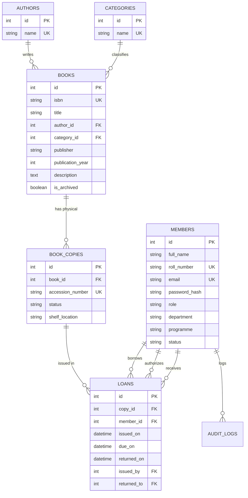

# LIBRANEST — University Library Management System

> **Academic Project Submission:** Database Management Systems (DBMS) TA1 + TA2  
> **Institution:** SGT University, Gurugram  
> **Programme:** B.Tech Computer Science and Engineering (AI & ML)  
> **Team Members:**  
> - **Pushkar** — Roll No: `251302024`  
> - **Prashant** — Roll No: `251302077`  
> - **Jatin** — Roll No: `251302100`  

---

## 🌟 Executive Overview
**LIBRANEST** is an enterprise-grade university library management application built from scratch to eliminate manual book lending bottlenecks, enforce strict relational inventory rules, track physical multi-copy accessions, and compute late fines with transactional precision.

### Key Capabilities
- **Strict 3NF Relational Architecture:** Normalization up to Third Normal Form with foreign key constraints, checks, and unique indexes.
- **Physical Copy Segregation:** Every book title has multiple physical impressions identified by distinct accession numbers (`ACC001`, `ACC002`, etc.).
- **Enforced Two-Loan Limit:** Students can never borrow more than 2 books simultaneously (enforced in the backend transactional boundary).
- **14-Day Lending Windows & Automated Fine Calculus:** Loans default to 14 calendar days; late returns incur **₹2.00 per calendar day**, while on-time returns carry zero fine.
- **Role-Based Access Control (RBAC):** Admin/Librarian control center separated from simplified student portals.
- **Data Visualizations:** Real-time database metrics, inventory counts, and category distribution using Recharts.
- **Downloadable Institutional Reports:** CSV exports for books, active loans, overdue accounts, and physical inventory.

---

## 🛠️ Technology Stack

| Layer | Technologies |
| :--- | :--- |
| **Frontend** | React 18, Vite, TypeScript, Tailwind CSS, Lucide Icons, Recharts, react-hot-toast |
| **Backend** | Python 3, FastAPI, Pydantic v2, Uvicorn |
| **ORM & Migrations** | SQLAlchemy ORM 2.0, Alembic Migrations |
| **Database** | SQLite (Local Development) / PostgreSQL (Production via `DATABASE_URL`) |
| **Security** | OAuth2 JWT Bearer Tokens, Bcrypt password hashing |
| **Testing** | pytest, pytest-asyncio, FastAPI TestClient |

---

## 📐 Relational Database Schema



---

## 🔑 Demo Credentials

A seed script (`backend/seed.py`) populates the database with realistic demo accounts across CSE, AI & ML:

| Account Type | Email | Password | Notes / Scenario |
| :--- | :--- | :--- | :--- |
| **Admin / Librarian** | `admin@libranest.demo` | `Admin@123` | Full administrative control desk |
| **Student (At Quota)** | `aakash@libranest.demo` | `Student@123` | Has 2 active loans (borrowing quota test) |
| **Student (Overdue)** | `bhavna@libranest.demo` | `Student@123` | Has active overdue loan with fine |
| **Student (Regular)** | `chirag@libranest.demo` | `Student@123` | 1 active loan within due date |
| **Student (Clean)** | `divya@libranest.demo` | `Student@123` | 0 active loans; ready to borrow |

*(All student accounts share default password `Student@123`)*

---

## 🚀 Local Development Setup

### Prerequisites
- Python 3.10+
- Node.js 18+ and npm

### 1. Backend Setup
```powershell
cd backend
python -m venv venv
.\venv\Scripts\activate
pip install -r requirements.txt

# Run migrations
alembic upgrade head

# Seed initial university dataset
python seed.py

# Start FastAPI development server (http://localhost:8000)
uvicorn app.main:app --host 0.0.0.0 --port 8000 --reload
```

### 2. Frontend Setup
```powershell
cd frontend
npm install
npm run dev
# Accessible at http://localhost:5173
```

---

## 🧪 Automated Testing Suite

Run all automated pytest suites validating the 2-loan limit, copy transitions, and fine calculations:

```powershell
cd backend
.\venv\Scripts\pytest -v
```

### Verified Test Scenarios (19/19 Passed)
1. `test_health`: Health check probe endpoint.
2. `test_admin_login`: Administrator OAuth2 token issuance.
3. `test_student_login`: Student authentication flow.
4. `test_invalid_login`: 401 response on incorrect password.
5. `test_create_book_admin`: Book creation in catalogue.
6. `test_create_member`: Member registration with unique roll number.
7. `test_issue_book`: Book issuance to student.
8. `test_copy_becomes_issued`: Physical copy changes status to `Issued`.
9. `test_issue_second_book`: Student successfully borrows second copy.
10. `test_reject_third_loan`: **Rejection of third simultaneous loan (2-loan limit).**
11. `test_return_book`: Return recording and copy release.
12. `test_copy_available_after_return`: Physical copy reverts to `Available`.
13. `test_due_date_calculation`: Exactly 14-day loan duration.
14. `test_fine_calculation`: ₹8.00 fine for 4 days late return.
15. `test_zero_fine_on_time`: ₹0.00 fine on or before due date.
16. `test_student_cannot_access_other_student`: Student data isolation (403).
17. `test_unauthorized_admin_api`: Student blocked from admin APIs (403).
18. `test_dashboard_admin`: Real database metrics generation.
19. `test_dashboard_denied_student`: Student blocked from admin dashboard (403).

---

## 🌐 Live Production Deployment

LIBRANEST is deployed and active in production:

| Service | Target | Production URL | Status |
| :--- | :--- | :--- | :--- |
| **Frontend UI** | Render Static Site | [https://libranest-ui.onrender.com](https://libranest-ui.onrender.com) | ✅ LIVE (HTTP 200) |
| **Backend API** | Render Web Service | [https://libranest-api.onrender.com](https://libranest-api.onrender.com) | ✅ LIVE (HTTP 200) |
| **Interactive Docs** | OpenAPI / Swagger UI | [https://libranest-api.onrender.com/docs](https://libranest-api.onrender.com/docs) | ✅ LIVE (HTTP 200) |
| **Health Check** | Health Probe | [https://libranest-api.onrender.com/health](https://libranest-api.onrender.com/health) | ✅ LIVE (`{"status":"ok"}`) |
| **Database** | Managed PostgreSQL | Render Postgres (`libranest_db`, Singapore) | ✅ LIVE (Alembic Migrated) |
| **Source Code** | GitHub Repository | [https://github.com/darrylkillsyou-arch/library-management-system](https://github.com/darrylkillsyou-arch/library-management-system) | ✅ LIVE (main branch) |

### 🔑 Demo Accounts for Faculty & Evaluators

| Role | Email / Username | Password | Purpose |
| :--- | :--- | :--- | :--- |
| **Admin / Librarian** | `admin@libranest.demo` | `Admin@123` | Full administrative control, issue/return books, inventory, reports, fines |
| **Student (At Quota)** | `aakash@libranest.demo` | `Student@123` | Demonstrates 2-loan limit (already has 2 active loans) |
| **Student (Clear)** | `priya@libranest.demo` | `Student@123` | Demonstrates fresh catalogue browsing and borrowing |
| **Student (Overdue)** | `rohit@libranest.demo` | `Student@123` | Demonstrates overdue loan and ₹2.00/day fine calculation |

---

## 📑 Academic Documentation
A comprehensive technical report covering normalization proofs, SQL scripts, and institutional scope is available at [DBMS_TA1_TA2_DOCUMENTATION.md](file:///DBMS_TA1_TA2_DOCUMENTATION.md).

---
**Course:** Database Management Systems (DBMS)  
**SGT University, Gurugram**  
*Academic Project &copy; 2026*
